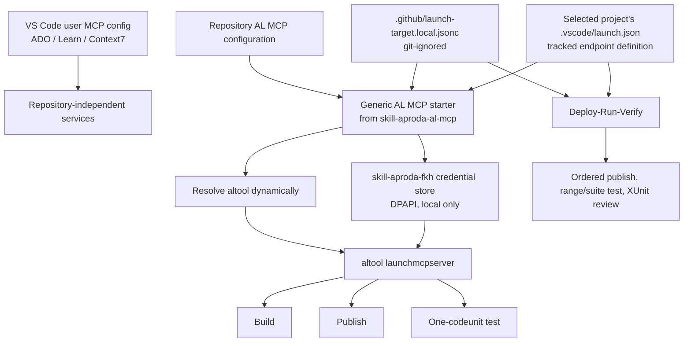

# Dynamic AL MCP Configuration - Design and Rollout Plan

> **Status:** Design proposal. The repository-local prototype is validated; the reusable ALDC capability described here is not implemented yet.
>
> **Last updated:** 2026-10-15
>
> **Scope:** Configure the official Business Central AL MCP server (`altool launchmcpserver`) dynamically for a developer's selected local target. This document covers Build, Publish, and single-codeunit test execution. It does not replace the Deploy-Run-Verify (DRV) cycle.

## 1. Decision Summary

The intended ALDC design is:

1. Keep generic, workstation-wide MCP services such as Azure DevOps, Microsoft Learn, and Context7 in the VS Code user MCP configuration.
2. Configure AL MCP per repository because its project set and selected Business Central target are repository and developer specific.
3. Store the developer's selected target in a visible, git-ignored local file at `.github/launch-target.local.jsonc`.
4. Keep the full endpoint definition in the existing AL `launch.json`; the local target file only names the launch project and configuration.
5. Resolve a UserPassword credential from the existing DPAPI-protected Fkh credential store using the target host name derived from the selected launch configuration.
6. Pass credentials only to the MCP server child process. Never write credentials to `mcp.json`, `launch-target.local.jsonc`, a tracked configuration file, terminal output, or the user/machine environment.
7. Add a new `skill-aproda-al-mcp` for the reusable AL MCP integration. It consumes the public Fkh credential-store functions but does not duplicate or absorb the Fkh transport skill.
8. Retain DRV as the authoritative multi-app, dependency-aware, range/suite test and report workflow. AL MCP is a fast primitive layer for explicit build, publish, and one-codeunit test operations.

## 2. Current Validated Prototype

The current project has a working repository-local prototype:

- [Base/.vscode/mcp.json](../../../Base/.vscode/mcp.json) starts an `al-mcp` stdio server through Windows PowerShell.
- [Base/.vscode/Start-AlMcpWithFkhCredential.ps1](../../../Base/.vscode/Start-AlMcpWithFkhCredential.ps1) launches the official AL MCP server for the `Base` and `Test` projects.
- The starter dynamically locates `altool.exe` under the user's installed `ms-dynamics-smb.al-*` VS Code extensions.
- It supports both currently known AL extension layouts:
  - `bin\\altool.exe` (current layout)
  - `bin\\win32\\altool.exe` (older layout)
- The starter loads the Fkh credential-store script with content-based PowerShell execution, which is required because this workstation's Software Restriction Policy blocks path-based script execution and module imports.
- It reads the stored UserPassword credential and sets `BC_SERVER_USERNAME` and `BC_SERVER_PASSWORD` only in the process that starts the MCP server.

The following operations have been exercised successfully against the developer target:

| Operation | Result |
|---|---|
| Start AL MCP with Base and Test projects | Server reached `AL MCP Server ready (STDIO mode)` |
| `al_build` for Base | Succeeded and generated `Aproda AG_Gustav Gerig AG Base_25.0.0.158.app` |
| `al_publish` for Base | Succeeded with `Synchronize` |
| `al_run_tests` for codeunit 59021 | 10 passed, 0 failed, 0 skipped |
| Two independent test calls for codeunits 59020 and 59021 | Both succeeded; 23 tests passed in total |

The prototype proves the integration path. It is not yet reusable because it currently contains:

- fixed Base and Test project parameters in `mcp.json`;
- a fixed credential-store key in the starter;
- an extension selection rule based on extension-folder modification time rather than a defined semantic-version policy;
- no reusable provisioning command or local target-profile contract.

## 3. Facts and Constraints

### 3.1 Repository and workspace model

This repository is multi-root: `.github`, `Base`, `Test`, and other folders are separate VS Code workspace roots. The AL MCP server needs explicit AL project paths, whereas the native VS Code AL tools can be sensitive to the active editor/project.

The current [Base/.vscode/mcp.json](../../../Base/.vscode/mcp.json) uses named `${workspaceFolder:...}` variables. This is portable across clones as long as the workspace names remain `Base` and `Test`.

The toolkit itself is located at the repository `.github` root. A local target file under `.github` is visible to Copilot in the existing workspace and does not require a file outside the visible workspace. A root-level developer file would be less discoverable when the root itself is not a workspace folder.

### 3.2 Target configuration source

[Base/.vscode/launch.json](../../../Base/.vscode/launch.json) is the source of truth for endpoint data:

- `environmentType`
- `server`
- `serverInstance`
- `port`
- `authentication`
- `tenant`
- schema/update and debugger settings

For the current Fkh target it defines `UserPassword` authentication and an HTTPS `*.cloudapp.azure.com` server. A reusable MCP setup must read the selected configuration instead of copying these values into a second file.

### 3.3 Credential handling

The Fkh credential store is owned by [skill-aproda-fkh](../../skills/skill-aproda-fkh/SKILL.md). It stores a `PSCredential` encrypted with DPAPI for the current user and computer, keyed by the normalized container host name.

For an MCP launch:

1. Select the target `launch.json` configuration.
2. Parse its `server` URI.
3. Use `Uri.Host` as the credential-store key when `authentication` is `UserPassword`.
4. Retrieve the credential through `Get-FkhStoredCredential`.
5. Inject the username/password into the environment of the MCP server process only.
6. Start `altool launchmcpserver`.

The credential must not be duplicated into DRV configuration or a new MCP profile. A DPAPI credential is intentionally local; it cannot be usefully or safely shared through Git.

No Fkh credential is required for Windows authentication. Cloud/AAD authentication uses the AL CLI's relevant authentication flow instead of Fkh credentials.

### 3.4 DRV remains a separate lifecycle workflow

[Test/deploy-run-verify.config.jsonc](../../../Test/deploy-run-verify.config.jsonc) currently references a `launchConfig` and adds DRV-specific behaviour: app order, runner material, runtime version, company, test range/suite, timeout and result handling.

DRV must retain these settings. It validates an ordered build -> deploy -> run -> review cycle, including dependency handling and aggregated test results. The generic AL MCP server currently accepts one codeunit per test call; it is not a replacement for DRV's range/suite execution and reporting.

## 4. Why AL MCP Must Not Be a Global User Server

A VS Code user MCP configuration is appropriate for services that are independent of the open repository, such as ADO, Learn, and Context7. AL MCP is different:

- It must load a specific set of AL projects.
- It may have several valid `launch.json` configurations.
- Each developer may use a different dev container, tenant, company, or authentication mode.
- A multi-root workspace may contain more than one AL repository or unrelated app folders.
- The active project cannot be inferred safely from an arbitrary editor tab.

A user-level `al-mcp` server would therefore have to guess the repository and target, which is unsuitable for publishing or running tests. The server should remain repository-local, while its target selection remains developer-local.

## 5. Target Architecture



### 5.1 New project-local target profile

The proposed profile is:

```text
.github/launch-target.local.jsonc
```

It is intentionally visible in the `.github` workspace root but ignored by Git. The profile selects a developer's target; it contains neither endpoint data nor secrets.

Initial schema:

```jsonc
{
  "version": 1,
  "launchProject": "Base",
  "launchConfig": "flobi-wan-kenobi-gustavgerig-dev-deployment",
  "mcpProjects": ["Base", "Test"]
}
```

| Property | Meaning |
|---|---|
| `version` | Enables future compatible schema changes. |
| `launchProject` | Repository-relative AL project that owns `.vscode/launch.json`. |
| `launchConfig` | Exact `name` of the selected configuration in that file. |
| `mcpProjects` | Repository-relative AL project folders to load into the MCP server, in the intended dependency-aware order. |

The profile is local because developers deliberately target different personal or team dev environments. It should be created by a provisioning command and never be copied through toolkit synchronization.

A later schema may define multiple named targets and an `activeTarget` field. The first implementation should use exactly one selected target to avoid configuration and UX complexity before the base path is proven across several projects.

### 5.2 Repository MCP configuration

A small repository MCP configuration remains necessary to make VS Code start the local server. It should:

- invoke the generic starter through `powershell.exe` with `-NoProfile` and `-NonInteractive`;
- use content-based script loading to meet the estate's SRP constraint;
- pass only a repository/workspace anchor to the starter;
- contain no secret, hostname, extension version, or developer-specific target;
- continue using named workspace-folder variables when the concrete `mcp.json` is app-local.

The configuration may be generated into the primary app's `.vscode/mcp.json`. Provisioning must never overwrite an existing `mcp.json` without an explicit merge/confirmation step.

### 5.3 Generic starter responsibilities

The future `Start-AprodaAlMcp.ps1` should:

1. Receive a repository root or a stable workspace anchor.
2. Read and validate `.github/launch-target.local.jsonc`.
3. Resolve all `mcpProjects` relative to the repository root and require an `app.json` in each.
4. Resolve `launchProject/.vscode/launch.json` and the exact named configuration.
5. Resolve the AL CLI from installed AL Language extensions.
6. For `UserPassword`, derive the credential key from the selected configuration's `server` URI and load the existing Fkh credential store.
7. Inject credentials into the MCP child process only.
8. Launch `altool launchmcpserver <project...> --transport stdio`.
9. Produce clear, non-secret errors for a missing profile, unknown launch configuration, missing app folder, invalid server URI, unavailable credential, or missing AL CLI.

The resolver should select the highest valid AL extension version using parsed semantic versions where possible. The current prototype selects the newest extension folder by modification timestamp, which works on the validated machine but is not a stable cross-machine version policy.

Both known executable layouts must stay supported until the extension establishes a stable documented location:

```text
<extension>/bin/altool.exe
<extension>/bin/win32/altool.exe
```

### 5.4 JSONC parsing requirement

Both `launch.json` and the proposed local profile are JSONC files. Windows PowerShell 5.1's standard `ConvertFrom-Json` does not provide a robust JSONC parser. The reusable starter must therefore use a comment-aware parser rather than brittle line or regular-expression stripping.

The implementation should first reuse an already available, tested JSONC parser in the ALDC/Aproda toolchain if one exists. If no such component exists, the starter should either:

- use a small, tested JSONC parser helper that preserves string literals correctly; or
- make the local profile strict JSON despite its `.jsonc` name and use a purpose-built parser only for `launch.json`.

This is an implementation gate, not an invitation to copy endpoint values out of `launch.json`.

## 6. Ownership and Reuse Boundaries

### 6.1 New `skill-aproda-al-mcp`

A new skill is preferable to expanding the Fkh skill because AL MCP is a developer-tool integration with uses beyond Fkh:

- local/remote Windows-authenticated OnPrem targets;
- UserPassword Fkh targets;
- cloud/AAD targets;
- build-only operation without any live target;
- external MCP hosts that invoke `altool launchmcpserver`.

The new skill should own:

- the profile contract and its validation;
- AL tool discovery;
- startup and lifecycle behaviour for AL MCP;
- project provisioning and idempotent generation/merge strategy;
- the boundary between MCP primitives and DRV;
- operational guidance for build, publish, and individual-codeunit tests.

### 6.2 Existing `skill-aproda-fkh`

`skill-aproda-fkh` remains the owner of:

- Fkh target classification and transport;
- the DPAPI credential store and its public functions;
- Fkh publish/inspection conventions;
- Dev Endpoint defaults and Fkh-specific safety rules.

The AL MCP starter may call its public credential-store functions. It must not duplicate the store implementation or hardcode Fkh credentials.

### 6.3 Existing DRV skill

`skill-aproda-deploy-run-verify` remains the owner of:

- ordered multi-app runtime validation;
- target-adapter choice;
- runner setup and test range/suite execution;
- XUnit parsing and final review/reporting.

The target profile can become its preferred source for `launchProject` and `launchConfig`, with the existing `deploy-run-verify.config.jsonc` `launchConfig` retained as a compatibility fallback during migration. DRV-specific settings must remain in its own project configuration.

## 7. Security Rules

1. A credential is never stored in `mcp.json`, `launch-target.local.jsonc`, `launch.json`, DRV configuration, Git, logs, diagnostics, or chat output.
2. Fkh credentials remain DPAPI-protected and local to the user and machine.
3. Credentials are injected only into the process that launches/hosts AL MCP. They are not set at user, machine, or shared terminal-session scope.
4. The starter derives a credential key from the selected target's URI host; it must not accept a free-form credential key from a tracked configuration file.
5. The starter treats a missing credential as a blocking, actionable error and must not prompt through non-interactive MCP startup.
6. `UserPassword` handling is conditional on the selected launch configuration. Windows and AAD paths must not attempt Fkh credential lookup.
7. Publishing and test execution remain write/runtime actions subject to the existing human-in-the-loop and target-selection rules. A successful build alone is not permission to publish.

## 8. Provisioning and Rollout Plan

### Phase 0 - Preserve the validated prototype

- Keep the current repository-local starter and `mcp.json` working until the reusable replacement passes the same checks.
- Do not change the current live target configuration merely to introduce abstraction.
- Record any AL CLI layout changes encountered during normal extension updates.

### Phase 1 - Approve the Aproda-layer change

A new `skill-aproda-al-mcp` and changes under `skill-aproda-*` are Aproda-layer edits. Before implementation:

1. State the governing decision in `decisions.aproda.md`.
2. Confirm whether the change relaxes an existing decision.
3. Obtain explicit user confirmation under D-16.
4. Implement in the Aproda fork as the source of truth and flow the approved change back there.

The likely new decision should describe the same generic-engine plus project-local, non-secret configuration pattern used by DRV, while keeping local developer target selection out of Git.

### Phase 2 - Implement the reusable capability

Create the new skill with:

- `SKILL.md` describing scope, security rules, supported authentication modes, and operational limits;
- a generic SRP-safe starter script;
- an idempotent provisioning script;
- a template/example for the local target profile;
- validation for app folders, target configuration, authentication mode, AL CLI discovery, and credential availability.

No generic tooling should automatically publish or run tests as part of provisioning.

### Phase 3 - Integrate with DRV without breaking existing projects

- Add local target-profile support to DRV as an optional preferred selector.
- Keep `deploy-run-verify.config.jsonc` `launchConfig` as fallback for existing repositories.
- Detect and fail clearly when both sources are present but select different launch configurations; never silently choose one.
- Validate the same target resolution for both MCP and DRV on at least one Fkh UserPassword target and one Windows-authenticated target when available.

### Phase 4 - Migrate this repository

- Generate the ignored `.github/launch-target.local.jsonc` for the current developer.
- Replace the hardcoded target key and project arguments in the current prototype with the generic starter.
- Restart `al-mcp` in VS Code.
- Run a build through MCP.
- With explicit authorization for shared-target writes, run a publish and one-codeunit test through MCP.
- Run the full DRV cycle separately to verify that its range/reporting path remains unchanged.

## 9. Acceptance Criteria

The reusable design is complete when all of the following are true:

- An AL extension update does not require editing a version-pinned `altool.exe` path.
- A developer can select a personal target without changing tracked files.
- The selected target is defined once and consumed consistently by MCP and DRV.
- Endpoint data is not duplicated outside `launch.json`.
- Fkh UserPassword credentials are resolved only from the existing local DPAPI store.
- No secret is written to a project file, terminal output, or global environment scope.
- A repository with no Fkh target can use AL MCP for build and supported authentication modes without importing Fkh-only behaviour.
- MCP build, publish, and individual-codeunit test functions remain usable for the selected target.
- DRV continues to provide dependency-aware multi-app deployment, test range/suite execution, XUnit parsing, and review output.
- Provisioning is idempotent and does not overwrite an existing developer MCP configuration without explicit consent.

## 10. Open Decisions and Risks

| Topic | Current position | Required resolution before implementation |
|---|---|---|
| Local profile directory | `.github/launch-target.local.jsonc` | Confirm the naming and add it to the project `.gitignore`. |
| Profile format | JSONC requested for readability | Select a robust JSONC parser compatible with Windows PowerShell 5.1. |
| AL extension ranking | Current prototype uses folder modification time | Implement a semantic-version comparison and documented ambiguity handling. |
| Workspace names | Current `mcp.json` uses `Base` and `Test` workspace names | Provisioner must discover or explicitly ask for project anchors instead of assuming these names in every repo. |
| Multiple targets | One selected target is sufficient initially | Add named targets only after the one-target contract is used successfully in more than one repository. |
| DRV migration | Existing DRV config remains valid | Define conflict handling when local and DRV target selectors disagree. |
| Scope of AL MCP use | Validated for build, publish, and one-codeunit tests | Keep DRV mandatory for full delivery validation; do not let a green single test imply full runtime acceptance. |

## 11. References

- [Current repository MCP configuration](../../../Base/.vscode/mcp.json)
- [Current credential-backed MCP starter](../../../Base/.vscode/Start-AlMcpWithFkhCredential.ps1)
- [Current Base launch configuration](../../../Base/.vscode/launch.json)
- [Current DRV configuration](../../../Test/deploy-run-verify.config.jsonc)
- [AL/BC tool and MCP reference](../../docs/copilot-reference.md)
- [Fkh credential-store and target guidance](../../skills/skill-aproda-fkh/SKILL.md)
- [Aproda design decisions](../../decisions.aproda.md), especially D-8 and D-16
