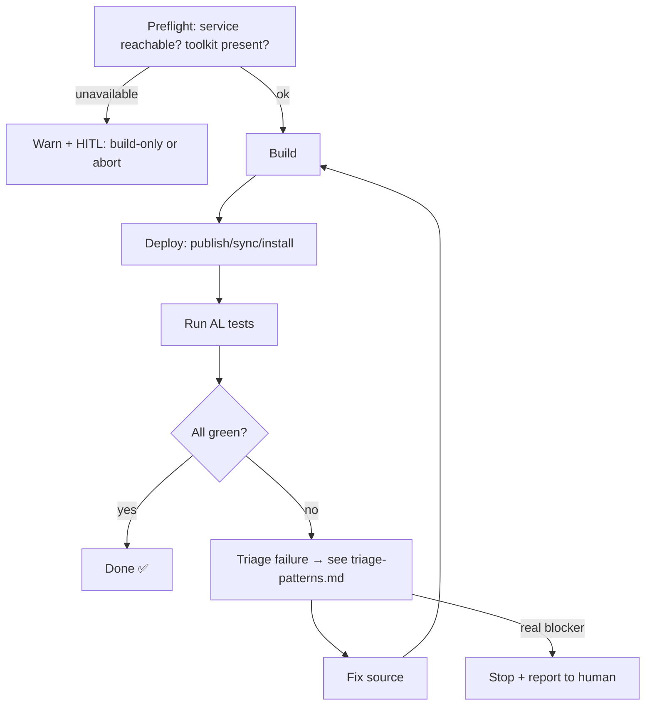

# Skill: Deploy-Run-Verify Cycle (Build → Deploy → Run → Review)

> **Aproda custom skill** — part of the Aproda ALDC layer. See [`../../readme.aproda.md`](../../readme.aproda.md) and [`../../decisions.aproda.md`](../../decisions.aproda.md).
> **Status: ASINST + FKH VALIDATED end-to-end through this entry point.** The ASINST engine runs the full build → deploy → materialize-runner → run → parse cycle against a live BC OnPrem service (e.g. 27/27 on the Audit Trail extension). The Fkh adapter (D-36) was live-validated 2026-09-12 against `flobi-wan-kenobi-straub-dev-deployment`: adapter classification, HTTP(S) preflight, Fkh backend/container resolution, publish, and a `UserPassword`-credentialed test run all passed for real, ending **26/26 passed, 0 failed** on the DC Blob Proxy Tests suite. D-39 supersedes its former Global-scope same-version removal path with Dev Endpoint publishing by default.

## Purpose

Own the Build → Deploy → Run → Review lifecycle for a **live BC OnPrem service**. Select the target adapter from the acknowledged `launch.json` configuration: ASINST and FKH both perform the validated full loop through their respective transport adapters.

## When to Load

Load this skill when:
- An implementation is finished and needs runtime verification before PR (LOW complexity → once, before PR).
- A conductor phase reaches its quality gate (MEDIUM/HIGH → at each phase boundary).
- Tests are failing and need the structured Fix → Deploy → Run → Review loop.
- Build/deploy against the OnPrem server needs to be (re)run.

> Trigger policy is bound to the **existing LOW / MEDIUM-HIGH** complexity tiers — not a new heuristic. See [Workflow](#workflow).

## The Loop (state machine)

**Loop discipline:** loop until all tests pass **or** a real blocker (service down, spec contradiction). **Do not** brute-force the same strategy repeatedly — if a fix doesn't move the result, escalate.

## Preflight gate (HITL)

- **Once per spec, before the first publish**, ask the user which environment to use, sourced from `launch.json` configurations (server/instance/tenant per `configuration`). Selection, not free-text.
- **Target selection comes from `.github/aldc.local.json`** (git-ignored; E-010), never from the DRV config. If the engine stops with `TARGET_SELECTION_<STATE>` (`ABSENT`, `INVALID`, `STALE`, `NOTOOLKIT`), its message already lists the available configurations (project, name, server, instance, authentication): show that list, ask the user to choose one, write the choice with `Set-AprodaAlLocalSelection -RepositoryRoot <repo> -LaunchProject <project> -LaunchConfig <name>` (loaded content-based from [`../skill-aproda-al-mcp/scripts/AprodaAlTarget.ps1`](../skill-aproda-al-mcp/scripts/AprodaAlTarget.ps1)), then ask for the environment acknowledgement below. **Selection ≠ acknowledgement**: choosing a configuration never replaces the acknowledgement. `NOTOOLKIT` means no `aldc.yaml` exists, so nothing can be stored — stop and report.
- **`CONFIG_MIGRATION_REQUIRED: <keys>`** means the tracked DRV config still carries target keys. Offer (HITL) to move the value into `aldc.local.json` (`Set-AprodaAlLocalSelection`) and to delete those keys from the tracked config; the deletion is part of the next commit. `fkhSyncMode` is not a target key and stays. `CONFIG_OBSOLETE_KEY` (empty keys) only needs the lines deleted in the next commit.
- **`TARGET_BLOCKED: <codes>`** means the selected `launch.json` configuration is unusable (e.g. `AUTH_MISSING`, `USERPASSWORD_OVER_HTTP`): report the messages; the fix is in `launch.json`, not in the DRV config.
- Record the choice + acknowledgement (session memory / phase report) → the loop then runs autonomously for that spec (no re-prompt per iteration).
- Only `server`-type (OnPrem/shared) configs require the acknowledgement; a local Cronus sandbox may be auto-allowed.
- **Service unavailable** → warn, differentiated: (a) no service reachable, (b) service up but **no Test Toolkit / no test environment**. Allow **build-only** (static validation via `alc.exe` + Dredd/BCQuality) with an explicit HITL acknowledgement; never hard-block. Warn **once per spec**, not per iteration.

  > Suggested wording: *"No BC service reachable. Quality is higher with a Cronus BC environment incl. Test Toolkit. Without a service only static validation (build + audit) is possible, no runtime verification. Proceed build-only?"*

- **Missing dependency on the target** → `Invoke-AprodaDeployRunVerify` runs `Test-DeployRunVerifyTargetDependencies` before any publish attempt, for both adapters, and throws a named `MISSING TARGET DEPENDENCY` error if the target is missing something the configured apps need. Treat that error as the trigger for [`references/dependency-resolution.md`](references/dependency-resolution.md) — the full closed loop: match against the known Aproda app sources, offer to the user, install only the confirmed file via `Install-DeployRunVerifyResolvedDependency`, then re-verify before letting the normal publish proceed. The engine never resolves or installs a missing dependency by itself.

## Build route — order of preference

The build step of this loop, and **every** build an agent triggers in this repository, follows this order. Take the first route that is available; fall through only when the one above is genuinely not applicable, and record which route actually ran.

| # | Route | Use when | Command / call |
|---|---|---|---|
| 1 | **DRV `buildonly`** | a `deploy-run-verify.config.jsonc` exists | `APRODA_DEPLOY_RUN_VERIFY_MODE='buildonly'` → [`Invoke-AprodaDeployRunVerify.ps1`](scripts/Invoke-AprodaDeployRunVerify.ps1) |
| 2 | **`al_build {"scope":"all"}`** | a fast source-level check across all projects is enough, or no DRV config exists | `{"scope":"all"}` |
| 3 | **`alc.exe /project:`** | the build must match what a publish would see, or there is exactly one known app folder | `alc.exe /project:"<App>" /packagecachepath:"<App>\.alpackages" /out:"<App>\<name>.app" /loglevel:Error` |
| 4 | **`altool workspace compile`** | generic multi-app graph | documented for BC 2026 wave 1+ (`--packagecachepath`, `--analyzers`, `--maxcpucount`); **documented ≠ verified on this estate** — record the result |
| 5 | **`al_build {"scope":"current"}`** | **only** in a workspace with exactly one AL project | `{"scope":"current"}` |

**Route 5 is unusable in a multi-root workspace.** `current` binds to the *active project*, which follows the focused editor; with a plan or spec file open under `.github` there is no active AL project at all (`.github` has no `app.json`). `scope:"all"` has no such dependency. Details and the measurement behind this: `docs/copilot-reference.md` → *AL/BC Tools & MCP Servers* (same relative path from this file in both the fork and a consuming project: [`../../docs/copilot-reference.md`](../../docs/copilot-reference.md)).

**Engine build route (E-010).** Inside route 1 the engine builds each app with **`altool compile`** (the verb passes its arguments to `alc`) and falls back to **`alc.exe`** only when `altool` is not available, has no `compile` command, cannot be started, or exits non-zero **without** a compiler diagnostic (`error AL\d{4}`). A compiler error is a real failure and never triggers the fallback. The route that ran is reported (see *Route reporting*).

**What each route proves.** Only route 1 refreshes the Base package in `Test/.alpackages` before building Test — it builds against the state that is also deployed. **Route 2 does not touch the package cache** (measured 2026-09-29: the Base `.app` in `Test/.alpackages` stayed six days old while an `alc.exe` build of Test failed with `AL0132`), so a green route-2 result says nothing about what a publish will see. Route 3 is the exact opposite — cache-true, and therefore failing until the fresh Base has been copied in; with `appsInOrder` apps, build Base first and refresh the cache yourself.

> **Build proof = exit code 0 + the path of the produced `.app`.** `al_getdiagnostics`, `read/problems` and `bclsp_codeQualityDiagnostics` report editor/language-server state, not a build. In a multi-root workspace the language server resolves across projects **from source**, so a clean Problems panel is not evidence that the build used the right Base.

## Target Adapter Selection

After the user acknowledges a `launch.json` selection, classify the target. The adapter decides **how the target is verified and inspected**, not how apps are published: **one publish chain serves both adapters** (E-010, D-53).

| Selected configuration | Adapter | Verification / inspection | Publish | Tests |
|---|---|---|---|---|
| `environmentType: OnPrem`, HTTPS server, hostname ending `.cloudapp.azure.com` | Fkh | Load [`skill-aproda-fkh`](../skill-aproda-fkh/SKILL.md); verify the launch hostname against `fkh listcontainers`; read state with `fkh getappinfo` | Dev Endpoint chain (below) | `altool runtests`, else the SRP-safe web-client runner |
| Any other acknowledged OnPrem configuration | ASINST | Remote PowerShell + NAV Management DLL, **read only** (state after publish, dependency check, one-time cleanup) | Dev Endpoint chain (below) | same |

This initial classifier is intentionally conservative and mechanical. A target that satisfies the Fkh candidate rule but cannot be verified by Fkh is unknown, not ASINST: stop and ask the user.

**Publish chain (both adapters), per app in dependency order:** (a) `altool publishapp` with the complete target bundle (`--server --serverinstance --port --authentication --tenant --environmenttype OnPrem`, no `--project`) → (b) direct multipart POST to the Dev Endpoint, **only** when (a) is unavailable or fails on invocation (no HTTP answer, connection/TLS/timeout, `altool` cannot start) → state verification (exact version installed and `Synced`, else `DEPLOY INCOMPLETE`). The engine never calls `Publish-NAVApp`, `Sync-NAVApp` or `fkh publishapp`; the Management DLL is not used to publish.

| Publish outcome | Engine action |
|---|---|
| `Published` | verify state |
| `AuthFailure` (`UserNotAuthenticated`, HTTP 401) | `UserPassword`: re-prompt **once** (stored credential skipped, D-43), then blocker; `Windows`: blocker. No route change. |
| `Duplicate` (HTTP 422, *duplicate package ID*) | stop; inspect the state ([`redeploy-recovery.md`](references/redeploy-recovery.md)); **never repeat** the publish |
| `ProtocolError` (HTTP 415) | stop (engine defect) |
| `Rejected` (other HTTP 4xx/5xx, sync/schema message, unrecognized failure) | stop with the redacted server text; no fallback |
| `InvocationFailure` | `altool` → direct POST (pinned for the rest of the run); direct POST → stop |

**Schema mode (D-39), both adapters and both routes.** The DRV config key `fkhSyncMode` (`Add` default | `ForceSync`) drives the publish: `Add` → `--schemaupdatemode Synchronize` / `SchemaUpdateMode=synchronize`; `ForceSync` → `ForceSync` / `forcesync`. Set `ForceSync` when a destructive schema change requires it and inform the user briefly — no separate confirmation (D-39); the run prints `SCHEMA MODE: ForceSync (fkhSyncMode)`. `Recreate` is never used. `forceUpgrade` (`--forceupgrade`) is a Tier-3 action: only after an explicit request for that run, via `APRODA_DEPLOY_RUN_VERIFY_FORCE_UPGRADE=1`; it is not available on the direct POST (`FORCEUPGRADE_REQUIRES_ALTOOL`). `DependencyPublishingOption` comes from the selected `launch.json` configuration (default `Default`).

## Test route

The test step runs **`altool runtests --testgroups`** first and the **web-client runner** ([`references/runner.md`](references/runner.md)) second. The engine reads the test codeunits of the test app from source (`Subtype = Test;` inside `testCodeunitRange`; ranges `a..b`, `a|b`, `a`, combinations) so setup/helper codeunits are never sent. It uses the web-client runner directly when `testSuite` is set to something other than `DEFAULT`, `companyName` is empty, `runtests --testgroups` is not available, the range is not `a..b`/`a|b` syntax (`RANGE_UNSUPPORTED`), a file declares more than one codeunit (`MULTI_OBJECT_FILE`), or an earlier invocation failure pinned the legacy route.

Fallback to the web-client runner happens **only** on `InvocationFailure` (no parseable result, process failure/timeout, other error code) or `Incomplete` (empty run, or a requested codeunit missing from the result). A **red** result (`TestRunFailed`) is a test result: it is reported as is and never re-run on another route. `UserNotAuthenticated` follows the D-43 retry above. Counts come from records with a non-empty `methodName` only; `Failures` are `<codeunitId>:<methodName>` with the error text and AL call stack in `FailureDetails`. Triage patterns: [`references/triage-patterns.md`](references/triage-patterns.md).

## Route reporting

Every run reports the route per step in the summary (`Routes = { Build, Deploy, Tests }`, each `{ Route, Reason }` with `altool | alc | devEndpoint | webClient | n/a`) and the tool (`AlTool = { Path, Version, Source }`). The console prints, after the `TIMING:` line, `ROUTE: build=<r> · deploy=<r> · tests=<r>` and one `ROUTE-FALLBACK: <step> → <route> (<reason>)` line per fallback. Quote these lines in the phase report.

## Modes and route environment

| `APRODA_DEPLOY_RUN_VERIFY_MODE` | Steps |
|---|---|
| `full` (default) | build → dependency preflight → publish → test |
| `buildonly` | build |
| `skipbuild` | dependency preflight → publish → test |
| `runonly` | test only (service preflight; no dependency check, no publish) — for a phase gate re-run without a redeploy |

| Variable | Values | Purpose |
|---|---|---|
| `APRODA_DEPLOY_RUN_VERIFY_FORCE_UPGRADE` | empty / `1` | per-run `--forceupgrade` (Tier 3, explicit request) |
| `APRODA_DEPLOY_RUN_VERIFY_TEST_ROUTE` | `auto` / `altool` / `webClient` | force a test route (route comparison) |
| `APRODA_DEPLOY_RUN_VERIFY_DEPLOY_ROUTE` | `auto` / `altool` / `devEndpoint` | force a publish route (fallback validation) |

A forced route that is unavailable stops with `ROUTE_UNAVAILABLE: <step>=<route>` instead of falling back. Do not force a route in a normal run.

## One-time ASINST cleanup (HITL)

Versions published by the former Management-DLL route (Tenant scope) or by a Global publish can linger on an NST. Provenance cannot be read from the NST (`PublishedAs` is absent on BC 28), so the cleanup lists candidates by **full package identity** and the human decides **per package**. Procedure, once per NST, only on request — never inside the loop or a phase gate:

1. List (read only): `Get-DeployRunVerifyCleanupCandidates -Cfg <resolved config>` → rows `{ Name, Publisher, Version, Scope, IsInstalled, SyncState, Candidate, Reason }`. An installed version is never a candidate. Show the table.
2. For **each** candidate the user wants removed, ask explicitly (name, publisher, version, scope, sync state; Global scope affects every tenant), then run `Remove-DeployRunVerifyAppVersion -Cfg <cfg> -Name <n> -Publisher 
 -Version <v>`. It refuses an installed version, unpublishes (tenant-scoped for Tenant scope, no `-ClearSchema`/`-DoNotSaveData`/`-ForceSync`) and re-reads to confirm absence.
3. Never remove a historical artifact (e.g. a documented `NotSynced` evidence leftover) without its own explicit confirmation. Fkh targets have no cleanup (`CLEANUP_ASINST_ONLY`).

## Workflow

### LOW complexity (direct `@AL Implementation Specialist`)
Run the loop **once**, after implementation, before PR. No phases to gate.

### MEDIUM / HIGH complexity (`@AL Development Conductor`, TDD phases)
Run the loop at **each phase boundary** as the quality gate. The conductor already cuts the code into phases (`phase-N-complete.md`) — the loop **attaches to those existing boundaries**; a phase is "complete" only when its loop is green.

## References (load on demand)

- [`skill-aproda-fkh`](../skill-aproda-fkh/SKILL.md) — Fkh target resolution, dependency sorting, state inspection and recovery (DRV does not publish with it).
- [`references/build-deploy.md`](references/build-deploy.md) — build routes, Base→Test symbol copy, the Dev Endpoint publish chain, schema modes, test-library prerequisite chain.
- [`references/redeploy-recovery.md`](references/redeploy-recovery.md) — duplicate package (422), schema-change recovery, NotSynced leftovers, and the explicitly requested Global-scope recovery.
- [`references/dependency-resolution.md`](references/dependency-resolution.md) — the full closed loop for a missing target dependency (ASINST + FKH): engine detection, HITL match against the known Aproda app sources, confirmed-file install, re-verification.
- [`references/runner.md`](references/runner.md) — the web-client runner (legacy test route): ServiceUrl, runner DLLs materialized from the K: BC DVD, central version-agnostic glue, **SRP content-based script loading**, result parsing.
- [`references/triage-patterns.md`](references/triage-patterns.md) — the falsifiable failure→cause→fix patterns (the gold), including the route/classification patterns.

## Scripts (reusable engine — `scripts/`)

The skill ships an **immutable, parameter-driven engine** so the agent never rebuilds the loop from scratch — it only supplies a tiny per-project config.

- [`scripts/AprodaDeployRunVerify.psm1`](scripts/AprodaDeployRunVerify.psm1) — engine. Key functions: `Resolve-DeployRunVerifyConfig` (also resolves central `glueDir` + the K: DVD source), `Invoke-DeployRunVerifyBuild` (altool compile → alc), `Invoke-DeployRunVerifyPublish` (altool publishapp → direct Dev Endpoint POST → state check; both adapters), `Invoke-DeployRunVerifyTests` (altool runtests → web-client runner), `Resolve-DeployRunVerifyClientSource` (derives the runner DLL source from the BC DVD), `Initialize-DeployRunVerifyRunner` (idempotently materializes the 4 client DLLs), `Invoke-DeployRunVerifyRun` (the web-client runner = legacy test route), `Get-DeployRunVerifySummary`, `Get-DeployRunVerifyCleanupCandidates` / `Remove-DeployRunVerifyAppVersion` (one-time ASINST cleanup), `Invoke-AprodaDeployRunVerify`. **Never edit per project.**
- [`scripts/Invoke-AprodaDeployRunVerify.ps1`](scripts/Invoke-AprodaDeployRunVerify.ps1) — thin entry (run via `Get-Content … -Raw | iex`). Loads the engine **content-based** (`[ScriptBlock]::Create`) because SRP blocks path-based execution.
- [`scripts/runner-glue/`](scripts/runner-glue/) — the 3 **version-agnostic** glue scripts (`ClientContext.ps1`, `PsTestFunctions.ps1` — MS canonical; `AprodaRunner.ps1` — Aproda wrapper). Central, shared by all projects/versions; never copied into `_runner/`.
- [`scripts/deploy-run-verify.config.template.jsonc`](scripts/deploy-run-verify.config.template.jsonc) — **copy** to `<project>/deploy-run-verify.config.jsonc`. Fill apps in dependency order, runner dir, `companyName`, server-side Mgmt DLL, and the runner-DLL source: preferably `bcDvdRoot` + `bcCountry` (K: BC DVD), else `runnerClientSource`. The rest auto-derives from the selected `launch.json` configuration + each `app.json`.
- [`scripts/README.md`](scripts/README.md) — full usage + what auto-derives + the **New project / repo bootstrap** checklist.

**First run in a NEW project/repo** → follow [`scripts/README.md` → *New project / repo bootstrap*](scripts/README.md): (1) ensure `.vscode/launch.json` has a `server` config and select it in `.github/aldc.local.json` (*Select AL Target* or `Set-AprodaAlLocalSelection`), (2) ensure the runner-DLL source is reachable (`bcDvdRoot`+`bcCountry` or `runnerClientSource`), (3) copy the config template + fill the few non-derivable values, (4) add `**/PowerShell/_runner/` and `**/PowerShell/_temp/` to `.gitignore`, (5) run the entry point — the **first run materializes** `_runner/<ver>/` from the DVD (later runs reuse it). **Subsequent runs** are just the entry point.

Mini-effort per project: copy the config, fill a few values, run the entry point. The 4 version-pinned client DLLs are **materialized on demand** from the K: BC DVD (`<bcDvdRoot>\<major>\<bcCountry>.<major>.<minor>\Applications\TestFramework\TestRunner\Internal`); the whole `_runner/` folder is git-ignored. Results: `<runnerDir>/<version>/TestResults.xml` (XUnit-style) → `Get-DeployRunVerifySummary` returns pass/fail counts + failed names.

> **SRP**: this estate blocks path-based PowerShell execution (Group Policy) — engine and glue are always loaded **content-based** via `[ScriptBlock]::Create((Get-Content -Raw))`. See `references/runner.md`. Canonical infra facts (SRP, K: DVD, NST servers, remote-PS): [`../../site-profile.aproda.md`](../../site-profile.aproda.md).

> The proven origin scripts (`Test/PowerShell/_Cycle.ps1`, `_RunTests.ps1`) stay project-local as the validated reference; the engine is their generalized, parameterized form (Aproda decision D-8).

## Constraints

- This skill owns the **process** (how/when to loop). Generic, citable BC truths (e.g. xRec semantics) belong in **BCQuality** (`custom/knowledge/...`) and are **linked, not duplicated**, from `references/triage-patterns.md`.
- Does **not** cover writing tests (→ `skill-testing`) or root-cause debugging strategy (→ al-developer / skill-debug). It orchestrates them.
- Deploy writes to a **shared OnPrem server** → the preflight HITL gate is mandatory (operational safety).
- Do not route an HTTPS `.cloudapp.azure.com` target through the ASINST engine unless the Fkh verification is explicitly resolved with the user.
- Every publish (both adapters) goes through the Business Central Dev Endpoint — `altool publishapp`, fallback the direct POST. Default schema mode is `synchronize`; inform the user briefly when `fkhSyncMode = ForceSync` is required, without requesting separate confirmation (D-39). `Recreate` and `forceUpgrade` are never applied implicitly; `fkh publishapp` and `Publish-NAVApp` are not used. Global-scope publishing is out of the engine and only on explicit user request.
